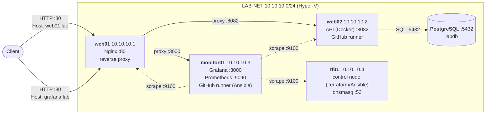

**English** · [Русский](README.ru.md)

# Home Infrastructure Lab

A home lab for practising Linux, networking, monitoring, automation and DevOps: a Python API backed by PostgreSQL, deployed with Ansible and GitHub Actions behind an Nginx reverse proxy on Hyper-V VMs.


## Architecture



Request path: `client → Nginx (web01:80) → API container (web02:8082 → 8081) → PostgreSQL`.

## Hosts

| Name | IP | Role | Services |
|---|---|---|---|
| web01 | 10.10.10.1 | Edge: reverse proxy and NAT | Nginx `:80`, node-exporter `:9100` |
| web02 | 10.10.10.2 | Application | API container `:8082`, PostgreSQL `:5432`, GitHub runner, node-exporter `:9100` |
| monitor01 | 10.10.10.3 | Monitoring and CI deploys | Grafana `:3000`, Prometheus `:9090`, GitHub runner (runs Ansible), node-exporter `:9100` |
| tf01 | 10.10.10.4 | Control node (Terraform/Ansible) | dnsmasq `:53`, node-exporter `:9100` |

All hosts run Ubuntu Server 26.04 and are reachable over SSH with key-based auth.

## Stack

| Tool | Purpose | Why |
|---|---|---|
| Terraform (`windsorcli/hyperv` 0.4.0) | Hyper-V VM definitions | Reproducible VM layout as code |
| Ansible | Configuration, app deploy, Nginx | Idempotent, agentless, readable playbooks |
| Nginx | Reverse proxy by `Host` header | Single entry point for every service |
| Python (stdlib HTTP + psycopg) | Telemetry API | Small surface, no framework needed for a health and ingest API |
| PostgreSQL 18 | Storage | Mature, SQL, easy to back up |
| Docker Compose | API packaging | Same image in CI and on the server |
| GitHub Actions | CI builds, deploy trigger | Self-hosted runners keep deploys inside the LAB-NET |
| Prometheus + Grafana | Metrics and dashboards | Standard open-source monitoring pair |

## Repository structure

```
.
├── .github/workflows/
│   ├── ci.yml              # API CI: builds the Docker image
│   └── deploy.yml          # Deploy API via Ansible on web02
├── ansible/
│   ├── ansible.cfg
│   ├── inventory.ini       # host groups: routers, servers, monitoring, terraform, lab
│   ├── site.yml            # main playbook
│   └── roles/
│       ├── common/         # base packages, SSH
│       ├── node_exporter/  # Prometheus node exporter
│       ├── nginx/          # reverse proxy on web01
│       └── api/            # API deploy on web02
├── backend/
│   ├── app.py              # HTTP API with psycopg
│   ├── Dockerfile
│   ├── compose.yaml
│   ├── requirements.txt
│   └── api.env.example
├── terraform/
│   ├── main.tf             # VM definitions
│   ├── variables.tf        # inputs (paths, sizes, switch names)
│   └── terraform.tfvars.example
└── README.md
```

Secrets, state files and local config are git-ignored: `api.env`, `terraform.tfvars`, `*.tfstate`, SSH keys.

## Quick start

Starting from an empty Hyper-V host:

1. **Network.** Create an internal virtual switch `LAB-NET`. Give web01 a second NIC on the `Default Switch` for outbound NAT.
2. **VMs.** Create the VMs with Terraform (not yet validated against a live host — see Roadmap):
   ```bash
   cd terraform
   cp terraform.tfvars.example terraform.tfvars   # set local disk and ISO paths
   terraform init
   terraform plan -out=tfplan
   terraform apply tfplan
   ```
   Install Ubuntu Server on each VM, create user `danil`, enable `openssh-server` and add your public key.
3. **Base config and proxy.** From a control machine with SSH access:
   ```bash
   cd ansible
   ansible-playbook site.yml
   ```
4. **PostgreSQL on web02** (manual, not in Ansible yet): create database `labdb`, user `labapp`, and table `telemetry` with columns `server_name`, `metric_name`, `metric_value`.
5. **API secrets.** Copy `backend/api.env.example` to `/home/danil/api/api.env` on web02 and set `DB_*`. The file is never committed.
6. **Deploy the API.** `ansible-playbook site.yml --limit web02`, or push to `main` and let GitHub Actions do it.
7. **Grafana on monitor01** (manual install, listens on `:3000`).

## How to verify

```bash
# Through the Nginx proxy (add web01.lab and grafana.lab to your hosts file first)
curl -i http://web01.lab/health        # HTTP/1.1 200 OK
curl -i http://web01.lab/health/db     # HTTP/1.1 200 OK when PostgreSQL is reachable

curl -i -X POST http://web01.lab/telemetry \
  -H "Content-Type: application/json" \
  -d '{"server_name":"web02","metric_name":"cpu_load","metric_value":0.42}'
# HTTP/1.1 201 Created

curl -I http://grafana.lab/            # HTTP/1.1 302 Found (login redirect)
```

Ansible idempotency: a second `ansible-playbook site.yml` run should report `changed=0` for unchanged hosts.

## Monitoring

- **Node metrics:** `node_exporter` on every VM (`:9100`), scraped by Prometheus on monitor01.
- **Dashboards:** Grafana on monitor01, reachable at `http://grafana.lab/` through Nginx.
- **Dashboard:** Node Exporter Full, showing all four hosts.


## Roadmap

- [ ] Verify `terraform plan` shows no changes for existing VMs (import into state, modules)
- [ ] Ansible `common` role: users, SSH hardening, ufw, NTP
- [ ] PostgreSQL managed by Ansible, with `pg_dump` backups on a systemd timer
- [ ] Kafka (KRaft, single node) for API events, with a consumer that writes to PostgreSQL
- [ ] Zabbix server and agents, with a dashboard and alert triggers
- [ ] k3s cluster, Helm chart or manifests for the API, Nginx routing to the Ingress
- [ ] CI linters: `terraform fmt/validate`, `ansible-lint`, `yamllint`, `ruff`, `pytest`

## Skills demonstrated

- **Infrastructure as code:** Terraform for Hyper-V VMs, with variables and state kept out of git.
- **Configuration management:** Ansible roles, inventory groups, idempotent playbooks, `--limit` and `--check --diff` workflows.
- **Networking:** LAN design with NAT uplink, hostname-based reverse proxy routing in Nginx.
- **Containers:** Docker image and Compose for the API, built in CI.
- **CI/CD:** GitHub Actions with a self-hosted runner that deploys inside the lab network.
- **Databases:** PostgreSQL setup, schema and access, connection from a containerised service.
- **Observability:** Prometheus node exporters and a Grafana instance behind the proxy.
- **Security hygiene:** no secrets in git, env-based configuration.
